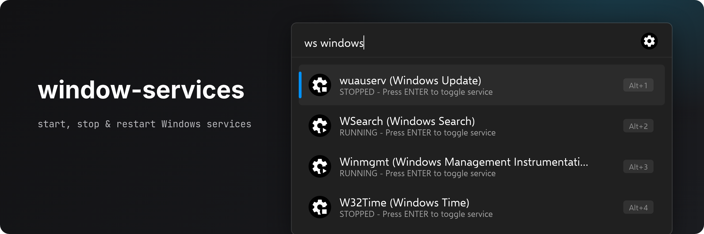

<!-- generated by readwright from docs/README.md.j2; edit the template, not this file -->


# Window Services

List, start, stop and restart Windows services from Flow Launcher.

[](https://github.com/Garulf/window-services/actions/workflows/tests.yml) [](https://github.com/Garulf/window-services/releases/latest) [](https://github.com/Garulf/window-services/releases/latest)

[](https://www.buymeacoffee.com/garulf) [](https://github.com/sponsors/Garulf)

## Features

* **Every service.** Lists all Windows services with their current state.
* **Search by either name.** Matches the service name (`wuauserv`) or the display name (`Windows Update`).
* **Toggle with Enter.** Stops a running service and starts a stopped one.
* **Start, stop or restart.** All three are in the context menu.
* **Any Windows language.** Reads `sc` output in the console's code page, including translated field names.

## Usage

Type `ws` followed by part of a service name:

```
ws bluetooth
```


Press `Enter` to toggle the selected service. Windows asks for administrator approval (UAC)
before it changes a service.

### Context menu

Open the context menu (`Shift+Enter` or right-click) to start, stop or restart a service:


## Installation

### Flow Launcher

In Flow Launcher, type:

```
pm install window services
```


### Manual installation

Download `window-services-<version>.zip` from the [latest release](https://github.com/Garulf/window-services/releases/latest) and unzip it into
`%appdata%\FlowLauncher\Plugins`, then restart Flow Launcher.

Pre-releases of the next version are published from the open release PR on the
[releases page](https://github.com/Garulf/window-services/releases) for testing. Flow Launcher won't offer them as updates.

## Requirements

* Windows 10 or 11
* Flow Launcher 1.17.0 or newer
* Python 3.8 or newer, which Flow Launcher can install for you

## Special thanks

[@taooceros](https://github.com/taooceros) and [@onesounds](https://github.com/onesounds)
